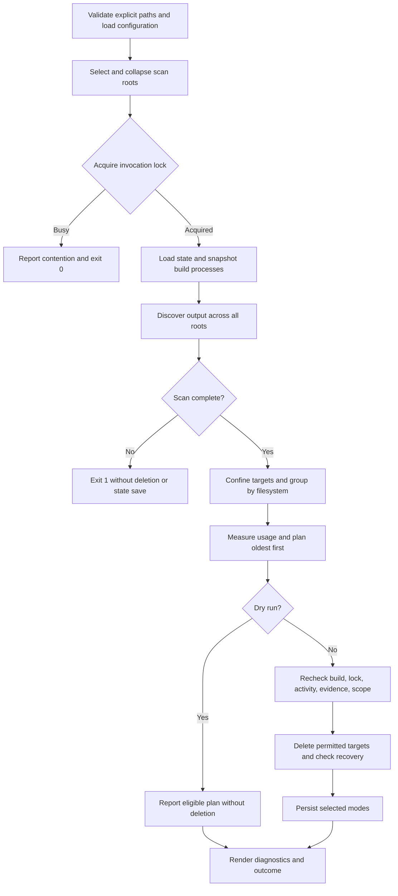
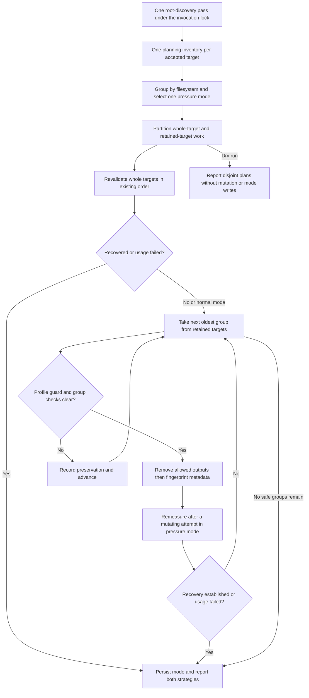

# rust-cleanup technical design

- **Status:** Implemented design in sections 1–10; proposed combined cleanup
  in section 11.
- **Audience:** Maintainers, reviewers, and Linux operators.
- **Updated:** 2026-11-12.
- **Implementation baseline:** Source imported in `c13079c`, with spelling
  corrections in `b7b9d05`; Python 3.14 or newer.
- **Scope:** Discovery, planning, reclamation, persistence, reporting, and a
  proposed combined target/artefact sweep.
- **Companion documents:** See [documentation contents](contents.md).

## 1. Problem and scope

Rust build output accumulates across repositories and worktrees. Cleaning one
workspace with `cargo clean` removes its generated output, but does not select
stale output across several directory trees according to filesystem capacity.
`rust-cleanup` supplies that selection policy: discover output once across the
configured roots, group it by backing filesystem, and reclaim eligible targets
oldest first. Cargo's own cleanup remains the alternative for deliberate
workspace or package cleanup.[^cargo-clean]

The tool must distinguish disposable build output from source trees, preserve
active or uninspectable targets, and explain why a candidate survived. Capacity
policy changes the inactivity threshold; it does not bypass the deletion
checks. Normal mode performs routine retention. Pressure and critical modes
stop once measured usage falls below their recovery watermarks.

The implementation is a synchronous, single-invocation Python command. It uses
standard-library adapters for filesystems, Linux process inspection, advisory
locks, and JSON persistence. It does not invoke Cargo, manage Cargo's package
cache, provide a daemon, or install a scheduler. Ansible provisioning remains
in the source `dev-env-rocky` repository.[^package]

Sections 1–10 record existing decisions. Section 11 proposes combined
whole-target and artefact cleanup, with its decision gate recorded separately
in ADR 001; it has not been implemented.

## 2. Terminology and operating assumptions

| Term                | Meaning                                                                          |
| ------------------- | -------------------------------------------------------------------------------- |
| Scan root           | An effective directory boundary selected for this invocation.                    |
| Candidate           | A directory considered because it is named `target` or holds `.rustc_info.json`. |
| Accepted output     | A candidate that passes the Cargo-evidence classification.                       |
| Filesystem identity | A canonical mount point paired with its device number.                           |
| Activity            | The newest observed modification time in an accepted output tree.                |
| Mode                | The normal, pressure, or critical retention policy for a filesystem.             |
| Recovery watermark  | The used-capacity percentage a pressure mode must fall below.                    |

The deletion boundary is a user's explicitly selected or configured directory
set. The operating assumption is a Linux development host where the invoking
account can inspect its build processes and remove its disposable output.
Process inspection uses `/proc`; `fcntl` locks coordinate cooperating
processes. The package therefore does not establish Windows or macOS
support.[^process]

A marker or Cargo-shaped directory is evidence used by the classifier, not
proof of ownership. Modification times are observations, not a build-completion
protocol. The design reduces accidental deletion through repeated checks; it
does not establish safety against an actor that deliberately changes the tree
between the final check and removal. Section 8 states the remaining races.

## 3. Architecture and sweep flow

The CLI validates inputs, composes adapters, acquires the invocation lock, and
renders the returned outcome. The sweep coordinates discovery, planning, and
reclamation without printing human-readable output. `CleanupRun` supplies
replaceable clocks, process detectors, filesystem operations, state storage,
and event emission. These boundaries let verification introduce changes between
planning and deletion without depending on a live build.[^sweep]

Figure 1 shows the normal control flow. Input and adapter failures can leave
this flow through the error contracts in section 8.



*Figure 1: One locked invocation discovers all roots before processing their
backing filesystems.*

An incomplete directory scan ends the sweep before deletion or state saving. An
individual target whose filesystem cannot be identified is instead preserved
with a warning; identified targets can still proceed. This distinction
separates an untrusted discovery result from a known target that cannot be
assigned a policy. Filesystems without discovered targets receive no capacity
assessment.[^sweep]

## 4. Configuration, roots, and discovery

Configuration precedence is command-line retention options over TOML values
over built-in defaults. Root selection separately chooses positional CLI paths
over `[scan].roots` over `~/.lody/repos` and `~/Projects`. A configured list
replaces the defaults, including when it is empty. The validated
[configuration example](../examples/config.toml) records the default settings.
The complete operator reference belongs in the [users' guide](users-guide.md).

Configured root expressions accept absolute paths and leading `~` or `~/`. They
reject relative paths and another user's home shorthand. Environment references
remain literal: `/srv/$WORK` names that literal directory. CLI relative paths
resolve against the invoking working directory. Selection canonicalizes and
collapses duplicate and nested roots to avoid repeated walks.[^roots]

An explicit missing or non-directory root fails the command. A configured
missing or non-directory root is reported and skipped. Missing built-in
defaults are reported only with verbose output. Inspection failures, including
an unreadable root or a symbolic link loop, fail the selection or scan rather
than silently narrowing it. Explicit status reads preserve that distinction
under Python 3.14, whose path predicates suppress operating-system
errors.[^pathlib]

Discovery considers directories named `target` and directories containing
`.rustc_info.json`. It does not treat every marked cache as Rust output. For a
considered directory, classification applies this order:[^discovery]

1. Refuse a symbolic link.
2. Refuse direct source markers `Cargo.toml` or `.git`.
3. Accept a recognized `CACHEDIR.TAG` file.
4. Otherwise require `.rustc_info.json` and profile evidence: at least one of
   `.cargo-lock`, `.fingerprint`, `deps`, or `build`, including the supported
   nested target/profile layout.
5. Record a fixed omission reason when evidence is insufficient.

This is a structural heuristic, not a parser for Cargo's internal metadata or a
cache-tag signature validator. Source markers take precedence over cache
markers. The walk excludes `.git`, `.svn`, `.hg`, `node_modules`, `__pycache__`,
`.pytest_cache`, `.cargo`, and `.rustup`; it does not traverse directory
links. A linked destination can be inspected to classify an omission, without
walking it for deletion. The selected scan root itself is never a deletion
candidate.

## 5. Pressure policy and persisted state

Usage is `used / total * 100` from `shutil.disk_usage`; zero total capacity is
unmeasurable. A filesystem's policy uses its persisted mode when available,
otherwise it derives a mode from the current reading. The following table
states the default transitions; configured thresholds replace these numbers.

| Previous mode    | Used capacity           | Selected mode |
| ---------------- | ----------------------- | ------------- |
| Absent or normal | Below 80%               | Normal        |
| Absent or normal | At least 80%, below 95% | Pressure      |
| Absent or normal | At least 95%            | Critical      |
| Pressure         | Below 75%               | Normal        |
| Pressure         | At least 75%, below 95% | Pressure      |
| Pressure         | At least 95%            | Critical      |
| Critical         | At least 90%            | Critical      |
| Critical         | At least 75%, below 90% | Pressure      |
| Critical         | Below 75%               | Normal        |

A pressure sweep requires usage strictly below 75% to recover; a critical sweep
requires strictly below 90%. Equality does not recover. Default inactivity
windows are two hours, ten minutes, and two minutes respectively. Eligibility
requires activity strictly older than the cutoff. Candidates at the cutoff
remain protected.[^pressure]

Planning fixes one wall-clock reading and one selected mode per filesystem for
the sweep. Reclamation remeasures usage after successful deletion in pressure
or critical mode, and stops before offering the next candidate once recovery is
observed. Normal mode applies retention without a recovery watermark. The
selected mode, rather than a newly downgraded mode, is persisted; a later sweep
applies the transition table to its next reading.[^pressure]

State keys combine mount point and device number with a NUL separator, escaped
in JSON. Version 1 has this shape; the values shown are illustrative:

```json
{
  "version": 1,
  "filesystems": {
    "/srv/work\u00002049": "pressure"
  }
}
```

Missing state starts an empty mapping. Invalid JSON, an unsupported version, or
an invalid mapping entry rejects the document as a whole and warns. Saving
writes a sibling temporary file with mode `0600`, flushes and synchronizes it,
replaces the destination, and synchronizes its parent directory. Failure before
replacement preserves the previous document; a later directory-sync failure can
report failure after replacement. This provides atomic replacement, not a
transaction spanning deletions and state.[^state]

## 6. Deletion ordering and protection

Planning snapshots activity, applies the initial build and Cargo-lock checks,
and orders eligible candidates by activity time then canonical path.
Immediately before each removal, reclamation evaluates these checks in a fixed
order:

1. Create a fresh process detector; preserve output owned by an active or
   uncertain build.
2. Probe existing profile `.cargo-lock` files; proceed only with a definite
   free result.
3. Read activity again; preserve unknown, changed, or insufficiently old output.
4. Reapply Cargo-evidence and source-tree classification.
5. Reject a link or a path that no longer resolves within an effective root.

The first failing check supplies the protection reason. Reordering the checks
would change that observable explanation, including whether a newly active
build outranks a changed timestamp.[^reclamation]

The process detector recognizes Cargo, compiler, documentation, linker, Kani,
and Verus command families. It examines command names, working directories,
command lines, and environment output directories. Named targets include
`CARGO_TARGET_DIR`, `CARGO_BUILD_TARGET_DIR`, and `--target-dir` forms;
arguments after `--` are not interpreted as Cargo options. Ownership also uses
worktree location heuristics. An incomplete process snapshot conservatively
protects all targets queried through that detector.[^process]

Cargo-lock probing opens existing regular profile locks read-only, without
creating them. It does not probe `CARGO_HOME` package-cache locks. Probe
absence only clears that check; it does not independently establish inactivity.
The probe and process checks are observations rather than a lock held across
the whole build/deletion protocol.

A dry run records the ordered eligible plan, skips destructive revalidation and
recovery measurement, and saves no mode changes. It still reads configuration,
state, process information, directory metadata, and initial usage, and can
create an invocation lock file or its parent directory. It is not a reservation
of output for a later real run.[^reclamation]

## 7. Interface and storage contracts

### 7.1 CLI and library boundary

`rust-cleanup [OPTIONS] [PATH ...]` maps to `rust_cleanup:main`. The
[users' guide](users-guide.md#command-reference) owns the option reference and
exit-status table. Status 0 includes lock contention and preservation cases; it
does not assert that every deletion succeeded. Status 3 means a processed
pressure-mode plan failed to establish recovery, not that every mounted
filesystem was measured.[^cli]

`cleanup_scan_roots(roots, run)` is the importable sweep boundary. Its caller
supplies already validated, unnested roots; the CLI's outer invocation lock is
not acquired by this library function. `CleanupOutcome` contains aggregate
counts, per-filesystem diagnostics, omissions, and unresolved-pressure status.
Its `deleted` count means planned deletions during a dry run. The historical
`rust_cleanup.cleanup` facade and two-value outcome unpacking remain
compatibility surfaces.[^sweep]

### 7.2 Files and configuration

XDG configuration and state roots use non-empty absolute overrides, otherwise
falling back to `.config` and `.local/state` below the resolved account home.
This follows the XDG distinction between configuration, persistent state, and
runtime files.[^xdg]

| Purpose                | Path or rule                                                                        |
| ---------------------- | ----------------------------------------------------------------------------------- |
| Optional configuration | `$XDG_CONFIG_HOME/rust-cleanup/config.toml`, with home fallback.                    |
| Selected mode state    | `$XDG_STATE_HOME/rust-cleanup/state.json`, with home fallback.                      |
| Invocation lock        | `$XDG_RUNTIME_DIR/rust-cleanup.lock` when non-empty; otherwise the state directory. |

The current lock-path implementation uses a non-empty `XDG_RUNTIME_DIR` as
supplied; it does not enforce the absolute-path validation used for config and
state roots. All scheduled and manual invocations must use consistent
configuration, state, and runtime environments to share a lock. A missing file,
even one named by `--config`, uses defaults. Unknown TOML keys and invalid
values fail validation before deletion.[^cli]

### 7.3 Reporting and telemetry

Standard output contains human summaries and optional target details. Standard
error contains warnings, filesystem diagnostics, and prefixed JSON telemetry.
`--verbose` controls per-target human detail, not telemetry emission.

`EventEmitter` accepts fixed operation, lifecycle, outcome, and mode
vocabularies; it filters unknown fields, structured values, invalid tokens, and
out-of-range counters. Each invocation supplies a correlation token. Durations
use a monotonic clock, while inactivity uses the captured wall-clock reading.
Telemetry aggregates counters rather than emitting a record for each candidate.

The `rust-cleanup-event` prefix followed by a space identifies event records.
The bounded event schema omits target paths, environment values, and raw
exception text. Human diagnostics can contain mount points, target paths, and
error messages; the privacy boundary applies to structured events, not the
complete stderr stream.[^telemetry]

## 8. Failure modes and limits

| Failure                   | Implemented response                                        | Limit                                                          |
| ------------------------- | ----------------------------------------------------------- | -------------------------------------------------------------- |
| Invalid explicit root     | Exit 1 before the sweep.                                    | No other root is cleaned.                                      |
| Invalid configuration     | Exit 2 before deletion.                                     | A missing config file is permitted.                            |
| Incomplete discovery      | Abandon the sweep without deletion or state saving.         | Metadata reads and lock acquisition may already have occurred. |
| Unknown target filesystem | Preserve that target and warn.                              | Other identified targets can proceed.                          |
| Initial usage unavailable | Preserve the filesystem's candidates and its previous mode. | This path can return 0; no recovery reading was established.   |
| Usage reread unavailable  | Stop that plan and report unresolved recovery.              | Earlier deletions remain completed.                            |
| Deletion failure          | Record failure and continue eligible work.                  | A recursive removal can have partially removed a tree.         |
| State-save failure        | Propagate the error; the CLI returns 1.                     | Completed deletions cannot be rolled back.                     |
| Lock contention           | Report a successful no-op.                                  | Different lock paths do not coordinate.                        |

There is a time-of-check/time-of-use interval between the last guard and
`shutil.rmtree`. A build can start, a path can change, or a mount can change
inside that interval. Timestamp equality can also miss modifications whose
recorded timestamps remain unchanged. Advisory probes do not make deletion an
atomic transaction with Cargo. The current design makes no hostile-mutation or
race-freedom claim.[^reclamation]

Permission restrictions can make process inspection uncertain and consequently
preserve all candidates. Disk capacity can remain exhausted because every
candidate is protected or because occupied space lies outside the roots. No
benchmark establishes scan cost, reclamation throughput, or behaviour at a
particular repository count.

## 9. Correctness invariants and verification

Verification targets observable safety decisions, not the assertion that the
suite happens to pass. The existing property tests use Hypothesis-generated
inputs and shrinking to expose smaller failing cases; they are not formal
proofs.[^verification]

| Invariant                                                                             | Mechanism and existing evidence                                                                                            | Unchecked boundary                                        |
| ------------------------------------------------------------------------------------- | -------------------------------------------------------------------------------------------------------------------------- | --------------------------------------------------------- |
| A complete selection contains no duplicate or nested roots.                           | Canonical outermost selection; generated lists of repeated, nested, and disjoint paths in `test_scan_roots.py`.            | Arbitrary mount mutation during selection.                |
| An incomplete scan cannot drive deletion or state saving.                             | Early abandonment; injected incomplete scans in `test_observability_sweep.py` and `test_safety_regressions.py`.            | Every possible real permission and I/O failure schedule.  |
| A failing guard preserves the candidate and names the first reason.                   | Ordered checks; transition witnesses and inter-check failures in `test_reclamation.py` and `test_reclamation_evidence.py`. | Mutation after the last check.                            |
| Pressure transitions return a known mode and a positive cutoff.                       | Generated utilization sequences in `test_config_and_pressure.py`; finite cases cover default hysteresis boundaries.        | Exhaustive arbitrary custom-threshold sequences.          |
| Distinct generated filesystem identities retain their modes after saving and loading. | NUL-separated keys; generated mount/device/mode mappings in `test_state.py`.                                               | Power-loss durability on every filesystem implementation. |
| Dry runs delete no targets and save no state.                                         | Separate plan-recording branch; dry-run contracts in sweep and reporting tests.                                            | Absence of lock-file side effects is not an invariant.    |
| Structured events contain only accepted fields and bounded values.                    | Emission filter; vocabulary, numeric, and secrecy contracts in observability tests.                                        | Privacy of human-readable diagnostics.                    |

The highest-risk combination surface crosses root origin, filesystem identity,
previous mode, current usage, build ownership, lock availability, changed
activity, and dry-run selection. Finite boundary cases cover transitions and
protection ordering. Generated cases cover root containment, mode sequences,
and state identities. CLI snapshots cover stable rendering after normalization.
These are focused projections, not exhaustive coverage of the Cartesian
product. There is no model-checked concurrent deletion protocol.

Actual systemd acceptance is separately gated by
`RUST_CLEANUP_HOST_ACCEPTANCE=1` and an available user manager. Ordinary local
verification does not establish scheduler installation or production host
behaviour. That boundary remains explicit rather than being inferred from a
passing host-independent suite.

### 9.1. Planned validation of existing code

[Roadmap step 1.3](roadmap.md#13-establish-a-stronger-verification-baseline-for-existing-cleanup-code)
adds assurance for the current whole-target implementation before combined
cleanup changes it. It is planned work, not a claim that CrossHair has already
checked the code. The inspected baseline has four Hypothesis properties:

| Existing property                                                 | Generated coverage already present                                                      | Limits that inform new work                                                                |
| ----------------------------------------------------------------- | --------------------------------------------------------------------------------------- | ------------------------------------------------------------------------------------------ |
| `test_transition_mode_always_produces_a_valid_mode`               | Observation sequences under `DEFAULT_CONFIG`; valid modes and positive cutoffs.         | No generated custom threshold configurations or full hysteresis-semantic oracle.           |
| `test_selection_is_ordered_deduplicated_and_containment_free`     | Duplicate/nested/disjoint selections from three fixed path shapes; exact outermost set. | No broad canonical-tree, idempotence, or first-declared survivor-order property.           |
| `test_state_round_trip_preserves_every_generated_identity`        | Valid generated mount/device/mode mappings survive a private save/load round trip.      | No generated malformed-state rejection or partially invalid document property.             |
| `test_oldest_first_order_is_monotonic_for_many_synthetic_targets` | Unique integer activity times in normal mode on one synthetic filesystem.               | No generated ties, unknown activity, input permutations, or filesystem-isolation property. |

These limits concern generated coverage. Named tests already cover some
individual boundary, tie, failure, and isolation examples; retain them rather
than treating them as missing or replacing them with redundant
generators.[^verification]

**CrossHair scope.** Qualify small, deterministic production predicates first:
`initial_mode`, `transition_mode`, `mode_cutoff`, `exit_watermark`,
`is_eligible`, and `is_recovered`. Contract domains must state valid policy
constraints, finite usage/cutoff ranges, and supported special activity values
such as the empty-target negative-infinity sentinel. Check threshold
inclusivity, non-premature critical recovery, selected-mode retention windows,
unknown/equal-age eligibility, and recovery's usage-failure veto. Do not spend
symbolic search on live `/proc`, filesystem traversal, advisory locks, or the
entire sweep. Regex-heavy parsers and broad mixed-type payloads instead start
with generated examples.

A symbolic contract must reach the actual production predicate; a copied model
or an impure operation hidden behind a pure-looking wrapper does not validate
that predicate. CrossHair only analyses code reachable from an active contract.
Use explicit supported contract syntax or its selected assertion-analysis mode,
and put search limits in CLI options or source directives rather than an
unsupported `pyproject.toml` section.[^crosshair-contracts] Verify tool and
Python 3.14 compatibility before claiming coverage. A failed import,
unsupported operation, timeout, or inconclusive result remains a recorded gap.
Preserve any counterexample as a normal regression and use bounded
`diffbehavior` where a qualified pure refactor must preserve behaviour.

**Hypothesis scope.** Extend existing properties only for new semantics or
domains. Construct valid custom pressure configurations instead of rejecting
most generated inputs. Add selection idempotence, survivor order, and
filesystem-isolation relations alongside the existing ordering and
outermost-set properties. For current duration, precedence, state-decoding, and
telemetry boundaries, prefer small built-in strategies with independent or
metamorphic assertions: unit scaling, higher-precedence override dominance,
whole-document rejection after an invalid state entry, and bounded event-schema
preservation. Do not duplicate valid state round trips merely to increase
property counts.

For whole-target reclamation, begin with bounded generated histories of build,
lock, activity, usage, and dry-run changes through the existing injected ports.
Use a rule-based state machine only when cross-step state exposes a gap that a
simple generated sequence cannot express clearly.[^hypothesis-stateful]
Exercise the real planner and reclaimer with recording adapters and reset their
state between examples. Modelled interleavings can check protection, recovery
stops, and filesystem isolation; they do not reproduce arbitrary OS scheduling.
Real lock, filesystem, subprocess, and systemd tests remain necessary.

Keep cheap properties in the ordinary pytest gate. Run qualified symbolic
searches under explicit per-target budgets on demand or for relevant changes,
with separately recorded scope, versions, contracts, result classifications,
and exclusions. Do not add CrossHair or a contract library as a runtime
dependency. Preserve shrunk failures with named examples rather than relying on
the disposable Hypothesis database. Later artefact work extends this baseline;
it does not replace current whole-target safety checks with a new model.

## 10. Rationale and references

| Choice                                                  | Alternative                                          | Reason and consequence                                                                                                       |
| ------------------------------------------------------- | ---------------------------------------------------- | ---------------------------------------------------------------------------------------------------------------------------- |
| Scan configured trees for positively classified output. | Invoke `cargo clean` for known workspaces.           | Supports worktrees and custom output names without invoking Cargo; retains a structural-evidence heuristic.                  |
| Apply policy per filesystem.                            | Use one global capacity reading and deletion order.  | Capacity belongs to a backing filesystem; output on another device cannot satisfy its recovery target.                       |
| Persist hysteretic modes.                               | Select a mode from one reading on every invocation.  | Separate entry and recovery thresholds prevent immediate downgrades near a boundary; state becomes part of the policy input. |
| Recheck several independent signals.                    | Trust discovery-time age alone.                      | Detects several changes before removal; still leaves a final concurrent-mutation interval.                                   |
| Use injected standard-library adapters.                 | Require Cargo subprocesses or a background service.  | Keeps the runtime dependency set empty and supports controlled verification of failures and changes between stages.          |
| Emit bounded events beside human diagnostics.           | Serialize arbitrary diagnostic objects as telemetry. | Provides fixed aggregate records without copying paths or raw exceptions into the event schema.                              |

## 11. Proposed combined target and artefact cleanup

This section proposes implementation work; it does not describe functionality
available in the current command.
[ADR 001](adr-001-combined-target-and-artefact-cleanup.md) records the proposed
architectural choice. The [implementation roadmap](roadmap.md) orders its
delivery and compatibility gates.

### 11.1. Goal and requirements

Space-constrained hosts run many Rust coding agents concurrently. A recent
write anywhere in a target keeps the whole directory young, even when most of
its cached outputs are old. Combined cleanup must reclaim those old groups
without waiting for the entire directory to become inactive.

| ID  | Required outcome                                                                                                                            |
| --- | ------------------------------------------------------------------------------------------------------------------------------------------- |
| R1  | One invocation, invocation lock, root discovery, and filesystem pressure decision serve both strategies.                                    |
| R2  | One ordinary planning inventory per target supplies whole-target activity and artefact metadata; safety rereads remain permitted.           |
| R3  | Artefact TTL inherits the selected whole-target TTL, including configuration and CLI overrides, unless explicitly overridden.               |
| R4  | Whole-target and descendant artefact operations never coexist in an executable plan.                                                        |
| R5  | Recent aggregate target activity does not veto old artefact groups; active or uncertain build ownership does.                               |
| R6  | Partial mutation requires a supported, acquired Cargo profile guard and fresh evidence.                                                     |
| R7  | Both strategies consume one measured filesystem recovery budget and stop together.                                                          |
| R8  | Existing target counters retain their meaning; artefact outcomes and failures are reported separately.                                      |
| R9  | Dry runs describe disjoint plans without payload or mode writes.                                                                            |
| R10 | The completed feature runs both strategies by default, supports rollback, and demonstrates concurrent-build and Cargo-layout compatibility. |

### 11.2. Cargo-sweep reference and compatibility boundary

The reference is cargo-sweep 0.8.0 at commit
`94a7cf012d40d314896c0fa6986132b0a1e931ba`. Its time mode derives a keep set
from access times of immediate children inside `.fingerprint/<name-hash>`. The
newest child access time determines each fingerprint's age. Outputs whose hash
is outside the keep set are removal candidates; this does not prove package
reachability or that a human considers an output unnecessary.[^sweep-time]

A hash is the final dash-separated component before the name's first dot, and
must contain exactly 16 ASCII hexadecimal characters. Selection joins matching
entries within one profile's `build`, `deps`, optional `native`, profile root,
and `.fingerprint` directories. It leaves unhashed final outputs, `examples`,
and `incremental` outside that mapping. Different profiles or targets never
share a group merely because their hashes match.[^sweep-groups]

The native implementation adopts this time-and-group model, with explicit
conservative differences:

- Require a corresponding, non-empty, readable fingerprint. Preserve orphan
  hashes and unknown names rather than sweeping the complement of a keep set.
- If several fingerprints map to one hash, the newest access observation
  protects the entire group; incomplete evidence preserves it.
- Preserve unsupported layouts, links, cross-filesystem members, and uncertain
  ownership. Do not recursively discover arbitrary nested `.fingerprint`
  directories or follow external build-directory configuration.
- Preserve the retained target, profile, `.fingerprint` container, cache marker,
  `.rustc_info.json`, and Cargo lock files. Only selected group members are
  removable.

Initially recognize structurally verified direct profiles and the supported
`<target-triple>/<profile>` layout, including custom profile names. Cargo
explicitly treats intermediate layout as internal and permits a separate build
directory; supporting that separate tree is deferred.[^cargo-layout]

### 11.3. Retention policy and proposed configuration

By default, artefact TTL equals the effective selected mode's `stale_after`:
normal `2h`, pressure `10m`, and critical `2m`. Custom whole-target settings
and CLI overrides flow through before inheritance. Retain sub-day precision and
do not silently apply an age floor.

The [proposed policy file](design/artefact-policy-proposal.toml) is a contract
for implementation, not a configuration accepted by the current release:

```toml
[cleanup.artefacts]
enabled = true
# Omit stale_after to inherit the selected mode's effective TTL.
# stale_after = "7d"
```

The completed implementation defaults `enabled` to true. `enabled = false` or
`--no-artefacts` restores whole-target-only selection. `--artefacts` explicitly
enables it; these CLI switches are mutually exclusive. Optional
`--artefact-stale-after DURATION` overrides the TOML artefact TTL; omitting
both overrides means inheritance, not a copied default captured at startup. An
explicit artefact TTL never enables a disabled strategy by itself.

Extend duration parsing additively with `d`, meaning exactly 86,400 seconds.
Existing `s`, `m`, and `h` inputs retain their meaning. Positive integer
durations are required; zero is not an alias for cargo-sweep's `--all` mode. No
persistent artefact age index or new pressure-state schema is required.

For a captured invocation time `now`, a group is eligible when its observed
fingerprint access age is at least its TTL. Future access timestamps have age
zero. This matches cargo-sweep's strict recent keep-set comparison: equality is
eligible. Whole-target eligibility keeps its current strictly-older comparison.
The duration defaults are shared; the two timestamp sources and boundary
comparisons remain explicit in the
[contract cases](design/combined-sweep-cases.json).

### 11.4. Shared inventory and component responsibilities

Keep the root and target discovery boundary from sections 3–4. Replace the
production planning-time activity-only walk with a target inventory that also
collects profile, fingerprint, hash-member, identity, and access metadata.
Derive the legacy newest-mtime result from that traversal. Equivalence against
`inspect_activity` is a compatibility obligation, including marker exclusion,
empty targets, and uncertainty. Partial cleanup applies stricter no-link rules
without silently changing whole-target activity semantics.

Retain compact group manifests and top-level member records, not arbitrary file
contents or a second serialized cache. Directory members need a streaming
metadata manifest so changed descendants can invalidate their planned removal.
Unknown files contribute to whole-target activity but need not become artefact
records. Memory should scale with groups and necessary member metadata rather
than retaining a second copy of every directory tree.

| Boundary                       | Responsibility and reuse rule                                                                                                       |
| ------------------------------ | ----------------------------------------------------------------------------------------------------------------------------------- |
| `TargetInventory`              | One target's whole-activity result, supported profiles, evidence completeness, and group snapshots.                                 |
| `ArtefactGroup`                | Target identity, relative profile, hash, newest fingerprint access, output members, fingerprint members, and revalidation manifest. |
| Operation plan                 | Tagged whole-target or artefact-group operations, with filesystem identity and deterministic ordering.                              |
| Profile mutation guard         | An acquired lease for the supported Cargo lock protocol, released after the group attempt.                                          |
| Existing sweep and usage ports | Own invocation, pressure mode, recovery, and state saving for both strategies.                                                      |

These are planned domain and adapter boundaries, not a new generic cleanup
framework. Reuse or extract the existing Cargo profile enumeration,
confinement, process ownership, clock, and usage helpers before adding
equivalents. `ActivityGetter` remains a compatibility surface for whole-target
callers. When a legacy injected adapter cannot supply a trustworthy partial
inventory, preserve partial candidates rather than silently performing a
separate host walk behind that adapter.

Figure 2 shows the combined flow. Ordinary planning traversals are shared;
revalidation deliberately reads relevant evidence again.



*Figure 2: Disjoint whole-target and artefact operations share one filesystem
recovery decision.*

### 11.5. Disjoint planning and common recovery

For each filesystem, select one mode and resolve both TTLs from the same
configuration and clock observation. First select whole-target operations using
the existing ordering and protection rules. Suppress every descendant artefact
operation for those targets. A whole-target operation invalidated during
revalidation has no fallback partial plan in that invocation.

Only retained targets enter artefact planning. Aggregate recency alone permits
that planning; active or uncertain build ownership and unresolved target safety
do not. Sort eligible groups by oldest fingerprint access time, then canonical
target path, relative profile, and hash. Whole-target operations retain
priority, so existing reclamation order does not depend on interpreting atime
and mtime as comparable activity measures.

Normal mode processes eligible whole targets, then eligible retained-target
groups. Pressure and critical modes check the shared recovery predicate before
each operation. A whole-target deletion can satisfy recovery and suppress the
entire artefact stage; a group deletion can stop later groups. Re-read usage
after each attempted group mutation, including partial failure, because a
failed recursive removal may already have freed space. Unknown usage stops
further mutation on that filesystem and leaves recovery unresolved. Other
filesystem plans continue independently.

Keep the selected pressure mode and existing state-save policy. Do not derive
free space from apparent file sizes or subtract an estimated byte count from a
usage reading. Hard links, sparse files, open descriptors, and concurrent agent
writes make that arithmetic unsound. Measured usage remains authoritative.

### 11.6. Concurrent-build guards and mutation protocol

Fresh process ownership, accepted-target evidence, root confinement, and group
identity must pass immediately before mutation. A recent aggregate target mtime
is not an artefact-age check and must not be reused as one. Changed fingerprint
access, changed members, or a changed manifest invalidate the entire group
before its first deletion. Do not recompare an unchanged target-wide snapshot
after earlier groups have modified that target; verify the remaining group's
own evidence instead.

The current `LockProbe` observes and releases locks. A false result can also
mean an unsupported filesystem, so it cannot authorize partial mutation.
Introduce an explicit `acquired`, `busy`, `unsupported`, or `unknown` profile
guard result. Proceed only while an acquired lease is held. Open existing
regular lock files without following links or creating replacements, acquire
the certified lock set in deterministic order, and release all acquired locks
if the complete lease cannot be obtained. Busy profiles never make the sweep
wait for an agent's build.

A local Cargo 1.99.1 experiment produced `.cargo-lock`, `.cargo-build-lock`, and
`.cargo-artifact-lock`. An offline build waited on an exclusive `.cargo-lock`
and completed after release. That establishes one command/version observation,
not a general protocol. Roadmap phase 1 must certify supported Cargo commands,
versions, and lock sets before destructive partial cleanup. Unknown protocols
preserve the profile; permission to delete must not be inferred from a filename.

Hold a lease for one group attempt, with fresh process inspection and member
revalidation inside it. Release promptly so queued builders can proceed, and
check cancellation between groups. The protocol must not remove or replace lock
files. Confinement checks cover parent components, links, source markers, and
device identity; use anchored filesystem operations where supported rather than
trusting a path string checked earlier.

Remove selected output members before their fingerprint metadata. If an output
removal fails, preserve remaining fingerprint evidence and record a partial
failure. Cancellation or failure does not roll back removed files. A later run
must preserve any resulting unknown cohort rather than assume it is an orphan
safe to delete. Existing whole-target race limits in section 8 remain; a lease
does not prove protection against arbitrary non-cooperating writers.

### 11.7. Access-time and resource limits

Fingerprint access time is an eviction heuristic. `relatime` can coalesce
access updates, and `noatime` disables them; neither is a dependency-liveness
oracle.[^access-times] This matters particularly when inherited TTLs are
minutes rather than days. Do not silently lengthen the requested TTL. Report
coalesced age confidence and warn once per affected filesystem when a sub-day
TTL relies on coalesced atime. Preserve partial candidates where access-time
support is known disabled or cannot be established; whole-target policy is
unaffected.

Reading metadata must not open fingerprint contents merely to calculate age.
That can refresh the evidence the cleaner is trying to measure. Empty,
unreadable, non-regular, or future-dated evidence receives an explicit result;
empty and unreadable evidence is unknown, while a valid future timestamp keeps
the group recent. The compatibility matrix must include `strictatime`,
`relatime`, known-disabled atime, and unavailable mount-policy information.

There must be one ordinary root-discovery pass and at most one ordinary
planning traversal of each accepted target. Metadata and process rereads for
guards are measured separately, not hidden to claim a single I/O operation. No
Cargo metadata subprocess, compiler invocation, upstream binary, or duplicate
whole-tree planning walk is part of the production pass. Performance evidence
must record planning walks, guard walks, process snapshots, peak memory, and
time to first safe reclamation under many-agent load. No latency benchmark is
yet available. Active output may exhaust the disk despite correct cleanup;
critical mode must not bypass protection to manufacture progress.

### 11.8. Reporting, compatibility, and deployment

Keep `CleanupOutcome.scanned`, `deleted`, and historical two-value unpacking
about target directories. Preserve existing whole-target dry-run conventions.
Add separately named planned, completed, failed, and preserved group counts,
completed member-path counts, and affected retained-target counts. Logical byte
estimates must be labelled estimates rather than bytes freed, and partial
failure must not increment a completed-group count.

Add bounded artefact inventory and deletion event operations and aggregate
counters to the existing emitter. Verbose human output can name group members;
structured events must not acquire path, environment, or raw-error payloads. A
preview lists disjoint operations and labels group counts as planned; it cannot
predict which deletions will satisfy recovery during the later run.

Retain the current exit-status meanings and precedence: fatal invocation errors
return 1, invalid configuration returns 2, unresolved measured recovery returns
3, otherwise 0. Per-operation failures remain visible in failure counts and
warnings, including when the overall status is 0. Do not mask status 3 in the
systemd service. Unknown age or unsupported profiles are preservation outcomes,
not proof that a filesystem is healthy.

The completed feature is enabled in the ordinary command and existing timer.
The rollout task must document that behaviour change before release and verify
`--no-artefacts` and `enabled = false` as rollback paths. Keep the current
working example configuration valid; proposed keys and flags belong in the
users' guide only once implemented. This documentation change adds no runtime
feature, package dependency, or production configuration change.

### 11.9. Verification and acceptance gates

The [JSON contract cases](design/combined-sweep-cases.json) fix TTL
inheritance, exact age boundaries, name parsing, descendant suppression, and
recovery outcomes. Their consistency has been checked independently; they are
proposed acceptance vectors, not evidence of an implementation. Extend them
into real filesystem and Cargo fixtures in the roadmap.

| Property                  | Required evidence                                                                                                                                                                       | Limit to state explicitly                               |
| ------------------------- | --------------------------------------------------------------------------------------------------------------------------------------------------------------------------------------- | ------------------------------------------------------- |
| Shared pass               | Instrument discovery and planning: one root pass and one inventory per target when both strategies are enabled.                                                                         | Guard rereads are extra work.                           |
| Inherited TTL             | Default and customized mode TTLs, CLI/TOML precedence, explicit day overrides, and pressure transitions produce the same effective default window for both strategies.                  | Timestamp sources and equality comparisons differ.      |
| Disjointness              | Property-generated target/profile/member plans contain no whole target and descendant group operation, including invalidated-parent cases.                                              | External mutation remains a runtime concern.            |
| Recent-target reclamation | A mixed-age target survives while its old recognized group is pruned and its recent group, roots, locks, and unknown entries survive.                                                   | Recency means recorded fingerprint atime.               |
| Build exclusion           | Real Cargo processes respect the held lease; busy and uncertain profiles are skipped, cancellation releases locks, and a build starting after planning is protected.                    | A supported command/version matrix is required.         |
| Group consistency         | Changed evidence aborts before mutation; injected member failures retain fingerprint evidence and report partial work.                                                                  | Interrupted mutations are not atomic.                   |
| Shared recovery           | Injected usage sequences stop both strategies at the same watermark, including after partial failure or an unreadable reread.                                                           | Do not fill the operator's host disk to test pressure.  |
| Rebuild correctness       | Real Cargo build/check/test succeed after permitted pruning; a subsequent no-change build remains valid. Compare eligible sets with the pinned upstream on readable supported fixtures. | Preserve and document intentional upstream differences. |

Combinatorial coverage crosses mode and prior state, inherited or explicit TTL,
whole-target eligibility, group age, active or uncertain ownership, lease
state, layout, atime policy, dry run, and usage failure. Use pairwise
generation plus directed cases for critical mode with a new build, a partially
failed group that reaches recovery, and a changed parent whose suppressed
groups must not reappear. Do not present pairwise coverage as a proof over all
schedules.

A separate many-agent acceptance slice must exercise isolated and shared
targets, unrelated active targets alongside reclaimable targets, concurrent
cleaner invocations sharing the lock, queued Cargo builds, and interruption.
Use deterministic process/usage adapters for stress and failure ordering, plus
real-Cargo command and rebuild checks. No formal race-freedom claim is made.

### 11.10. Deferred scope

The initial combined feature excludes toolchain-installed filtering, explicit
toolchain hashes, timestamp markers, target-size quotas, `--all`, orphan-hash
recovery, `incremental`, `examples`, and unhashed final-output pruning. It also
excludes separate external build-directory discovery, more permissive
profile-scoped build ownership, Windows support, and any relaxation of active
build protection in critical mode. Reconsider each only with its own evidence
and decision; none is a prerequisite for the requested combined sweep.

[^cargo-clean]: [Cargo clean reference](https://doc.rust-lang.org/cargo/commands/cargo-clean.html),
                consulted 2026-11-12.
[^package]: [Package configuration](../pyproject.toml) and
            [import provenance](developers-guide.md#source-import).
[^process]: [Process ownership](../rust_cleanup/active_build.py), [process inspection](../rust_cleanup/proc_inspection.py),
            and [Cargo lock probing](../rust_cleanup/cargo_locks.py).
[^sweep]: [Sweep orchestration](../rust_cleanup/sweep.py), [run and outcome contracts](../rust_cleanup/diagnostics.py),
          and [filesystem adapters](../rust_cleanup/filesystem.py).
[^roots]: [Root selection](../rust_cleanup/roots.py) and
          [configured root expressions](../rust_cleanup/scan_root_expressions.py).
[^pathlib]: [Python 3.14 pathlib documentation](https://docs.python.org/3.14/library/pathlib.html#querying-file-type-and-status),
            consulted 2026-11-12;
            [explicit root inspections](../rust_cleanup/roots.py).
[^discovery]: [Discovery](../rust_cleanup/discovery.py), [Cargo-evidence classification](../rust_cleanup/cargo_layout.py),
              and [multi-root confinement](../rust_cleanup/sweep_discovery.py).
[^pressure]: [Pressure transitions](../rust_cleanup/pressure.py), [planning](../rust_cleanup/planning.py), [recovery predicates](../rust_cleanup/plans.py),
             and [usage readings](../rust_cleanup/usage.py).
[^state]: [State format and replacement protocol](../rust_cleanup/state.py).
[^reclamation]: [Ordered reclamation guards](../rust_cleanup/reclamation.py), [activity revalidation](../rust_cleanup/reclaim.py),
                and [recursive removal](../rust_cleanup/filesystem.py).
[^cli]: [CLI and exit statuses](../rust_cleanup/cli.py), [configuration validation](../rust_cleanup/config_loading.py),
        and [invocation lock](../rust_cleanup/locking.py).
[^xdg]: [XDG Base Directory Specification](https://specifications.freedesktop.org/basedir/latest/),
        consulted 2026-11-12;
        [implemented config and state fallback](../rust_cleanup/xdg.py).
[^telemetry]: [Event validation and diagnostic logging](../rust_cleanup/observability.py)
              and [sweep event boundaries](../rust_cleanup/sweep_telemetry.py).
[^verification]: [Pressure verification](../tests/test_config_and_pressure.py), [root-selection properties](../tests/test_scan_roots.py), [state round trips](../tests/test_state.py),
                 [oldest-first properties](../tests/test_pressure_cleanup.py),
                 and [deletion guard contracts](../tests/test_reclamation.py).

[^sweep-time]: [cargo-sweep time selection](https://github.com/holmgr/cargo-sweep/blob/94a7cf012d40d314896c0fa6986132b0a1e931ba/src/fingerprint.rs#L109-L169)
               and
               [day conversion](https://github.com/holmgr/cargo-sweep/blob/94a7cf012d40d314896c0fa6986132b0a1e931ba/src/main.rs#L223-L232).
[^sweep-groups]: [Hash parsing and profile-group removal](https://github.com/holmgr/cargo-sweep/blob/94a7cf012d40d314896c0fa6986132b0a1e931ba/src/fingerprint.rs#L39-L59)
                 and
                 [member directories](https://github.com/holmgr/cargo-sweep/blob/94a7cf012d40d314896c0fa6986132b0a1e931ba/src/fingerprint.rs#L206-L288).
[^cargo-layout]: [Cargo build-cache layout and stability boundary](https://doc.rust-lang.org/cargo/reference/build-cache.html),
                 consulted 2026-11-12.
[^access-times]: [Linux mount access-time options](https://man7.org/linux/man-pages/man8/mount.8.html),
                 including `relatime`, `strictatime`, and `noatime`, consulted
                 2026-11-12.

[^crosshair-contracts]: [CrossHair contract targeting and configuration](https://crosshair.readthedocs.io/en/latest/contracts.html),
                        consulted 2026-11-12.
[^hypothesis-stateful]: [Hypothesis stateful testing guidance](https://hypothesis.readthedocs.io/en/latest/stateful.html),
                        including when ordinary generated sequences suffice,
                        consulted 2026-11-12.
