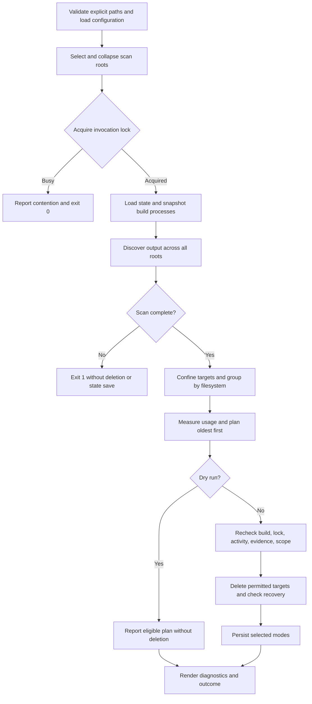

# rust-cleanup technical design

- **Status:** Living description of the implemented system.
- **Audience:** Maintainers, reviewers, and Linux operators.
- **Updated:** 2026-11-12.
- **Implementation baseline:** Source imported in `c13079c`, with spelling
  corrections in `b7b9d05`; Python 3.14 or newer.
- **Scope:** Discovery, planning, reclamation, persistence, and reporting.
- **Companion documents:** [Users' guide](users-guide.md),
  [developer guide](developers-guide.md), and
  [repository layout](repository-layout.md). The implementation defines the
  executable contracts; this document explains their shape and limits.

## 1. Problem and scope

Rust build output accumulates across repositories and worktrees. Cleaning one
workspace with `cargo clean` removes its generated output, but does not select
stale output across several directory trees according to filesystem capacity.
`rust-cleanup` supplies that selection policy: discover output once across the
configured roots, group it by backing filesystem, and reclaim eligible targets
oldest first. Cargo's own cleanup remains the alternative for deliberate
workspace or package cleanup.[^cargo-clean]

The tool must distinguish disposable build output from source trees, preserve
active or uninspectable targets, and explain why a candidate survived. Capacity
policy changes the inactivity threshold; it does not bypass the deletion
checks. Normal mode performs routine retention. Pressure and critical modes
stop once measured usage falls below their recovery watermarks.

The implementation is a synchronous, single-invocation Python command. It uses
standard-library adapters for filesystems, Linux process inspection, advisory
locks, and JSON persistence. It does not invoke Cargo, manage Cargo's package
cache, provide a daemon, or install a scheduler. Ansible provisioning remains
in the source `dev-env-rocky` repository.[^package]

This document records existing decisions. It introduces no new runtime
mechanism or accepted architecture change requiring a separate decision record.

## 2. Terminology and operating assumptions

| Term                | Meaning                                                                          |
| ------------------- | -------------------------------------------------------------------------------- |
| Scan root           | An effective directory boundary selected for this invocation.                    |
| Candidate           | A directory considered because it is named `target` or holds `.rustc_info.json`. |
| Accepted output     | A candidate that passes the Cargo-evidence classification.                       |
| Filesystem identity | A canonical mount point paired with its device number.                           |
| Activity            | The newest observed modification time in an accepted output tree.                |
| Mode                | The normal, pressure, or critical retention policy for a filesystem.             |
| Recovery watermark  | The used-capacity percentage a pressure mode must fall below.                    |

The deletion boundary is a user's explicitly selected or configured directory
set. The operating assumption is a Linux development host where the invoking
account can inspect its build processes and remove its disposable output.
Process inspection uses `/proc`; `fcntl` locks coordinate cooperating
processes. The package therefore does not establish Windows or macOS
support.[^process]

A marker or Cargo-shaped directory is evidence used by the classifier, not
proof of ownership. Modification times are observations, not a build-completion
protocol. The design reduces accidental deletion through repeated checks; it
does not establish safety against an actor that deliberately changes the tree
between the final check and removal. Section 8 states the remaining races.

## 3. Architecture and sweep flow

The CLI validates inputs, composes adapters, acquires the invocation lock, and
renders the returned outcome. The sweep coordinates discovery, planning, and
reclamation without printing human-readable output. `CleanupRun` supplies
replaceable clocks, process detectors, filesystem operations, state storage,
and event emission. These boundaries let verification introduce changes between
planning and deletion without depending on a live build.[^sweep]

Figure 1 shows the normal control flow. Input and adapter failures can leave
this flow through the error contracts in section 8.



*Figure 1: One locked invocation discovers all roots before processing their
backing filesystems.*

An incomplete directory scan ends the sweep before deletion or state saving. An
individual target whose filesystem cannot be identified is instead preserved
with a warning; identified targets can still proceed. This distinction
separates an untrusted discovery result from a known target that cannot be
assigned a policy. Filesystems without discovered targets receive no capacity
assessment.[^sweep]

## 4. Configuration, roots, and discovery

Configuration precedence is command-line retention options over TOML values
over built-in defaults. Root selection separately chooses positional CLI paths
over `[scan].roots` over `~/.lody/repos` and `~/Projects`. A configured list
replaces the defaults, including when it is empty. The validated
[configuration example](../examples/config.toml) records the default settings.
The complete operator reference belongs in the [users' guide](users-guide.md).

Configured root expressions accept absolute paths and leading `~` or `~/`. They
reject relative paths and another user's home shorthand. Environment references
remain literal: `/srv/$WORK` names that literal directory. CLI relative paths
resolve against the invoking working directory. Selection canonicalizes and
collapses duplicate and nested roots to avoid repeated walks.[^roots]

An explicit missing or non-directory root fails the command. A configured
missing or non-directory root is reported and skipped. Missing built-in
defaults are reported only with verbose output. Inspection failures, including
an unreadable root or a symbolic link loop, fail the selection or scan rather
than silently narrowing it. Explicit status reads preserve that distinction
under Python 3.14, whose path predicates suppress operating-system
errors.[^pathlib]

Discovery considers directories named `target` and directories containing
`.rustc_info.json`. It does not treat every marked cache as Rust output. For a
considered directory, classification applies this order:[^discovery]

1. Refuse a symbolic link.
2. Refuse direct source markers `Cargo.toml` or `.git`.
3. Accept a recognized `CACHEDIR.TAG` file.
4. Otherwise require `.rustc_info.json` and profile evidence: at least one of
   `.cargo-lock`, `.fingerprint`, `deps`, or `build`, including the supported
   nested target/profile layout.
5. Record a fixed omission reason when evidence is insufficient.

This is a structural heuristic, not a parser for Cargo's internal metadata or a
cache-tag signature validator. Source markers take precedence over cache
markers. The walk excludes `.git`, `.svn`, `.hg`, `node_modules`, `__pycache__`,
`.pytest_cache`, `.cargo`, and `.rustup`; it does not traverse directory
links. A linked destination can be inspected to classify an omission, without
walking it for deletion. The selected scan root itself is never a deletion
candidate.

## 5. Pressure policy and persisted state

Usage is `used / total * 100` from `shutil.disk_usage`; zero total capacity is
unmeasurable. A filesystem's policy uses its persisted mode when available,
otherwise it derives a mode from the current reading. The following table
states the default transitions; configured thresholds replace these numbers.

| Previous mode    | Used capacity           | Selected mode |
| ---------------- | ----------------------- | ------------- |
| Absent or normal | Below 80%               | Normal        |
| Absent or normal | At least 80%, below 95% | Pressure      |
| Absent or normal | At least 95%            | Critical      |
| Pressure         | Below 75%               | Normal        |
| Pressure         | At least 75%, below 95% | Pressure      |
| Pressure         | At least 95%            | Critical      |
| Critical         | At least 90%            | Critical      |
| Critical         | At least 75%, below 90% | Pressure      |
| Critical         | Below 75%               | Normal        |

A pressure sweep requires usage strictly below 75% to recover; a critical sweep
requires strictly below 90%. Equality does not recover. Default inactivity
windows are two hours, ten minutes, and two minutes respectively. Eligibility
requires activity strictly older than the cutoff. Candidates at the cutoff
remain protected.[^pressure]

Planning fixes one wall-clock reading and one selected mode per filesystem for
the sweep. Reclamation remeasures usage after successful deletion in pressure
or critical mode, and stops before offering the next candidate once recovery is
observed. Normal mode applies retention without a recovery watermark. The
selected mode, rather than a newly downgraded mode, is persisted; a later sweep
applies the transition table to its next reading.[^pressure]

State keys combine mount point and device number with a NUL separator, escaped
in JSON. Version 1 has this shape; the values shown are illustrative:

```json
{
  "version": 1,
  "filesystems": {
    "/srv/work\u00002049": "pressure"
  }
}
```

Missing state starts an empty mapping. Invalid JSON, an unsupported version, or
an invalid mapping entry rejects the document as a whole and warns. Saving
writes a sibling temporary file with mode `0600`, flushes and synchronizes it,
replaces the destination, and synchronizes its parent directory. Failure before
replacement preserves the previous document; a later directory-sync failure can
report failure after replacement. This provides atomic replacement, not a
transaction spanning deletions and state.[^state]

## 6. Deletion ordering and protection

Planning snapshots activity, applies the initial build and Cargo-lock checks,
and orders eligible candidates by activity time then canonical path.
Immediately before each removal, reclamation evaluates these checks in a fixed
order:

1. Create a fresh process detector; preserve output owned by an active or
   uncertain build.
2. Probe existing profile `.cargo-lock` files; proceed only with a definite
   free result.
3. Read activity again; preserve unknown, changed, or insufficiently old output.
4. Reapply Cargo-evidence and source-tree classification.
5. Reject a link or a path that no longer resolves within an effective root.

The first failing check supplies the protection reason. Reordering the checks
would change that observable explanation, including whether a newly active
build outranks a changed timestamp.[^reclamation]

The process detector recognizes Cargo, compiler, documentation, linker, Kani,
and Verus command families. It examines command names, working directories,
command lines, and environment output directories. Named targets include
`CARGO_TARGET_DIR`, `CARGO_BUILD_TARGET_DIR`, and `--target-dir` forms;
arguments after `--` are not interpreted as Cargo options. Ownership also uses
worktree location heuristics. An incomplete process snapshot conservatively
protects all targets queried through that detector.[^process]

Cargo-lock probing opens existing regular profile locks read-only, without
creating them. It does not probe `CARGO_HOME` package-cache locks. Probe
absence only clears that check; it does not independently establish inactivity.
The probe and process checks are observations rather than a lock held across
the whole build/deletion protocol.

A dry run records the ordered eligible plan, skips destructive revalidation and
recovery measurement, and saves no mode changes. It still reads configuration,
state, process information, directory metadata, and initial usage, and can
create an invocation lock file or its parent directory. It is not a reservation
of output for a later real run.[^reclamation]

## 7. Interface and storage contracts

### 7.1 CLI and library boundary

`rust-cleanup [OPTIONS] [PATH ...]` maps to `rust_cleanup:main`. The
[users' guide](users-guide.md#command-reference) owns the option reference and
exit-status table. Status 0 includes lock contention and preservation cases; it
does not assert that every deletion succeeded. Status 3 means a processed
pressure-mode plan failed to establish recovery, not that every mounted
filesystem was measured.[^cli]

`cleanup_scan_roots(roots, run)` is the importable sweep boundary. Its caller
supplies already validated, unnested roots; the CLI's outer invocation lock is
not acquired by this library function. `CleanupOutcome` contains aggregate
counts, per-filesystem diagnostics, omissions, and unresolved-pressure status.
Its `deleted` count means planned deletions during a dry run. The historical
`rust_cleanup.cleanup` facade and two-value outcome unpacking remain
compatibility surfaces.[^sweep]

### 7.2 Files and configuration

XDG configuration and state roots use non-empty absolute overrides, otherwise
falling back to `.config` and `.local/state` below the resolved account home.
This follows the XDG distinction between configuration, persistent state, and
runtime files.[^xdg]

| Purpose                | Path or rule                                                                        |
| ---------------------- | ----------------------------------------------------------------------------------- |
| Optional configuration | `$XDG_CONFIG_HOME/rust-cleanup/config.toml`, with home fallback.                    |
| Selected mode state    | `$XDG_STATE_HOME/rust-cleanup/state.json`, with home fallback.                      |
| Invocation lock        | `$XDG_RUNTIME_DIR/rust-cleanup.lock` when non-empty; otherwise the state directory. |

The current lock-path implementation uses a non-empty `XDG_RUNTIME_DIR` as
supplied; it does not enforce the absolute-path validation used for config and
state roots. All scheduled and manual invocations must use consistent
configuration, state, and runtime environments to share a lock. A missing file,
even one named by `--config`, uses defaults. Unknown TOML keys and invalid
values fail validation before deletion.[^cli]

### 7.3 Reporting and telemetry

Standard output contains human summaries and optional target details. Standard
error contains warnings, filesystem diagnostics, and prefixed JSON telemetry.
`--verbose` controls per-target human detail, not telemetry emission.

`EventEmitter` accepts fixed operation, lifecycle, outcome, and mode
vocabularies; it filters unknown fields, structured values, invalid tokens, and
out-of-range counters. Each invocation supplies a correlation token. Durations
use a monotonic clock, while inactivity uses the captured wall-clock reading.
Telemetry aggregates counters rather than emitting a record for each candidate.

The `rust-cleanup-event` prefix followed by a space identifies event records.
The bounded event schema omits target paths, environment values, and raw
exception text. Human diagnostics can contain mount points, target paths, and
error messages; the privacy boundary applies to structured events, not the
complete stderr stream.[^telemetry]

## 8. Failure modes and limits

| Failure                   | Implemented response                                        | Limit                                                          |
| ------------------------- | ----------------------------------------------------------- | -------------------------------------------------------------- |
| Invalid explicit root     | Exit 1 before the sweep.                                    | No other root is cleaned.                                      |
| Invalid configuration     | Exit 2 before deletion.                                     | A missing config file is permitted.                            |
| Incomplete discovery      | Abandon the sweep without deletion or state saving.         | Metadata reads and lock acquisition may already have occurred. |
| Unknown target filesystem | Preserve that target and warn.                              | Other identified targets can proceed.                          |
| Initial usage unavailable | Preserve the filesystem's candidates and its previous mode. | This path can return 0; no recovery reading was established.   |
| Usage reread unavailable  | Stop that plan and report unresolved recovery.              | Earlier deletions remain completed.                            |
| Deletion failure          | Record failure and continue eligible work.                  | A recursive removal can have partially removed a tree.         |
| State-save failure        | Propagate the error; the CLI returns 1.                     | Completed deletions cannot be rolled back.                     |
| Lock contention           | Report a successful no-op.                                  | Different lock paths do not coordinate.                        |

There is a time-of-check/time-of-use interval between the last guard and
`shutil.rmtree`. A build can start, a path can change, or a mount can change
inside that interval. Timestamp equality can also miss modifications whose
recorded timestamps remain unchanged. Advisory probes do not make deletion an
atomic transaction with Cargo. The current design makes no hostile-mutation or
race-freedom claim.[^reclamation]

Permission restrictions can make process inspection uncertain and consequently
preserve all candidates. Disk capacity can remain exhausted because every
candidate is protected or because occupied space lies outside the roots. No
benchmark establishes scan cost, reclamation throughput, or behaviour at a
particular repository count.

## 9. Correctness invariants and verification

Verification targets observable safety decisions, not the assertion that the
suite happens to pass. The existing property tests use Hypothesis-generated
inputs and shrinking to expose smaller failing cases; they are not formal
proofs.[^verification]

| Invariant                                                                             | Mechanism and existing evidence                                                                                            | Unchecked boundary                                        |
| ------------------------------------------------------------------------------------- | -------------------------------------------------------------------------------------------------------------------------- | --------------------------------------------------------- |
| A complete selection contains no duplicate or nested roots.                           | Canonical outermost selection; generated lists of repeated, nested, and disjoint paths in `test_scan_roots.py`.            | Arbitrary mount mutation during selection.                |
| An incomplete scan cannot drive deletion or state saving.                             | Early abandonment; injected incomplete scans in `test_observability_sweep.py` and `test_safety_regressions.py`.            | Every possible real permission and I/O failure schedule.  |
| A failing guard preserves the candidate and names the first reason.                   | Ordered checks; transition witnesses and inter-check failures in `test_reclamation.py` and `test_reclamation_evidence.py`. | Mutation after the last check.                            |
| Pressure transitions return a known mode and a positive cutoff.                       | Generated utilization sequences in `test_config_and_pressure.py`; finite cases cover default hysteresis boundaries.        | Exhaustive arbitrary custom-threshold sequences.          |
| Distinct generated filesystem identities retain their modes after saving and loading. | NUL-separated keys; generated mount/device/mode mappings in `test_state.py`.                                               | Power-loss durability on every filesystem implementation. |
| Dry runs delete no targets and save no state.                                         | Separate plan-recording branch; dry-run contracts in sweep and reporting tests.                                            | Absence of lock-file side effects is not an invariant.    |
| Structured events contain only accepted fields and bounded values.                    | Emission filter; vocabulary, numeric, and secrecy contracts in observability tests.                                        | Privacy of human-readable diagnostics.                    |

The highest-risk combination surface crosses root origin, filesystem identity,
previous mode, current usage, build ownership, lock availability, changed
activity, and dry-run selection. Finite boundary cases cover transitions and
protection ordering. Generated cases cover root containment, mode sequences,
and state identities. CLI snapshots cover stable rendering after normalization.
These are focused projections, not exhaustive coverage of the Cartesian
product. There is no model-checked concurrent deletion protocol.

Actual systemd acceptance is separately gated by
`RUST_CLEANUP_HOST_ACCEPTANCE=1` and an available user manager. Ordinary local
verification does not establish scheduler installation or production host
behaviour. That boundary remains explicit rather than being inferred from a
passing host-independent suite.

## 10. Rationale and references

| Choice                                                  | Alternative                                          | Reason and consequence                                                                                                       |
| ------------------------------------------------------- | ---------------------------------------------------- | ---------------------------------------------------------------------------------------------------------------------------- |
| Scan configured trees for positively classified output. | Invoke `cargo clean` for known workspaces.           | Supports worktrees and custom output names without invoking Cargo; retains a structural-evidence heuristic.                  |
| Apply policy per filesystem.                            | Use one global capacity reading and deletion order.  | Capacity belongs to a backing filesystem; output on another device cannot satisfy its recovery target.                       |
| Persist hysteretic modes.                               | Select a mode from one reading on every invocation.  | Separate entry and recovery thresholds prevent immediate downgrades near a boundary; state becomes part of the policy input. |
| Recheck several independent signals.                    | Trust discovery-time age alone.                      | Detects several changes before removal; still leaves a final concurrent-mutation interval.                                   |
| Use injected standard-library adapters.                 | Require Cargo subprocesses or a background service.  | Keeps the runtime dependency set empty and supports controlled verification of failures and changes between stages.          |
| Emit bounded events beside human diagnostics.           | Serialize arbitrary diagnostic objects as telemetry. | Provides fixed aggregate records without copying paths or raw exceptions into the event schema.                              |

[^cargo-clean]: [Cargo clean reference](https://doc.rust-lang.org/cargo/commands/cargo-clean.html),
                consulted 2026-11-12.
[^package]: [Package configuration](../pyproject.toml) and
            [import provenance](developers-guide.md#source-import).
[^process]: [Process ownership](../rust_cleanup/active_build.py), [process inspection](../rust_cleanup/proc_inspection.py),
            and [Cargo lock probing](../rust_cleanup/cargo_locks.py).
[^sweep]: [Sweep orchestration](../rust_cleanup/sweep.py), [run and outcome contracts](../rust_cleanup/diagnostics.py),
          and [filesystem adapters](../rust_cleanup/filesystem.py).
[^roots]: [Root selection](../rust_cleanup/roots.py) and
          [configured root expressions](../rust_cleanup/scan_root_expressions.py).
[^pathlib]: [Python 3.14 pathlib documentation](https://docs.python.org/3.14/library/pathlib.html#querying-file-type-and-status),
            consulted 2026-11-12;
            [explicit root inspections](../rust_cleanup/roots.py).
[^discovery]: [Discovery](../rust_cleanup/discovery.py), [Cargo-evidence classification](../rust_cleanup/cargo_layout.py),
              and [multi-root confinement](../rust_cleanup/sweep_discovery.py).
[^pressure]: [Pressure transitions](../rust_cleanup/pressure.py), [planning](../rust_cleanup/planning.py), [recovery predicates](../rust_cleanup/plans.py),
             and [usage readings](../rust_cleanup/usage.py).
[^state]: [State format and replacement protocol](../rust_cleanup/state.py).
[^reclamation]: [Ordered reclamation guards](../rust_cleanup/reclamation.py), [activity revalidation](../rust_cleanup/reclaim.py),
                and [recursive removal](../rust_cleanup/filesystem.py).
[^cli]: [CLI and exit statuses](../rust_cleanup/cli.py), [configuration validation](../rust_cleanup/config_loading.py),
        and [invocation lock](../rust_cleanup/locking.py).
[^xdg]: [XDG Base Directory Specification](https://specifications.freedesktop.org/basedir/latest/),
        consulted 2026-11-12;
        [implemented config and state fallback](../rust_cleanup/xdg.py).
[^telemetry]: [Event validation and diagnostic logging](../rust_cleanup/observability.py)
              and [sweep event boundaries](../rust_cleanup/sweep_telemetry.py).
[^verification]: [Pressure verification](../tests/test_config_and_pressure.py), [root-selection properties](../tests/test_scan_roots.py), [state round trips](../tests/test_state.py),
                 and [deletion guard contracts](../tests/test_reclamation.py).
